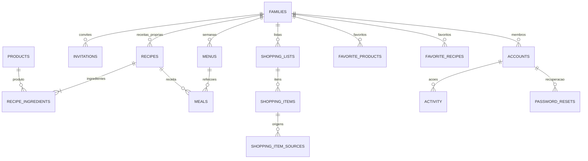

# Arquitetura

## Decisões

O backend usa Spring Boot 4.1.2, compatível com Java 21. A compilação utiliza `release=21`; o container compila, testa e executa com Java 21. A compatibilidade foi consultada na [documentação Spring Boot](https://docs.spring.io/spring-boot/system-requirements.html). O springdoc 3.2 é compatível com Boot 4.1 segundo a [matriz oficial](https://springdoc.org/#what-is-the-compatibility-matrix-of-springdoc-openapi-with-spring-boot).

CSS simples, com variáveis, componentes reutilizáveis e media queries, mantém uma linguagem visual consistente sem uma cadeia adicional de ferramentas CSS. O calendário continua vertical; a navegação passa da lateral no computador para a barra inferior no telemóvel. Ilustrações geométricas e símbolos decorativos não representam fotografias de receitas.

A sessão é guardada no servidor e o identificador em cookie HttpOnly, SameSite=Lax e Secure em produção. Não existem tokens de acesso em localStorage. Cada escrita exige CSRF, incluindo login e registo. O ID da sessão muda no login e na renovação; logout invalida a sessão. As sessões em memória terminam ao reiniciar o servidor; os dados persistidos permanecem e podem ser recuperados após novo login.

Os pedidos obtêm a família da conta autenticada no servidor. Nunca se usa um familyId enviado pelo cliente como prova de autorização. IDs inexistentes e registos de outras famílias devolvem 404. Receitas globais só podem ser lidas ou copiadas.

SSE é suficiente porque as escritas usam REST e só precisamos de comunicar alterações do servidor para o navegador. Os eventos não transportam dados privados: invalidam as consultas TanStack Query da família depois do commit. Reconexão e heartbeat mantêm o estado da ligação visível. A implementação destina-se a **uma instância de backend**; várias instâncias exigem um canal de eventos partilhado e sessões partilhadas.

## Estrutura

```text
frontend/
  src/
    main.tsx             autenticação, providers, navegação e shell
    api.ts               cookies, CSRF e erros HTTP
    types.ts             contratos TypeScript
    ui.tsx               componentes e vocabulário visual
    pages/               Semana, Compras, Receitas, Decidir, Família, Recuperação
    test/                testes dos fluxos de compras
    styles.css
  public/                PWA e ícones
backend/
  src/main/java/pt/nossomenu/
    AuthController, Security, SessionGuard, AuthRateLimit, RecoveryController
    ApiController        adaptação HTTP e DTOs
    MenuService          regras de menu e compras, autorização e auditoria
    ShoppingCalculator   cálculo e reconciliação puros
    SuggestionProvider, RuleBasedSuggestions
    Products             nomes canónicos e equivalências
    Store                acesso JPA e locks
    Model                entidades relacionais
    Catalogue            seed transacional de receitas
    Events, Errors
  src/main/resources/db/migration/
  src/test/
scripts/                 smoke HTTP e geração dos ícones
deploy/                  HTTPS
```

## Modelo relacional



Cada conta pertence a uma única família, por isso a associação e o papel estão em `accounts`, sem uma tabela de associação redundante. As preferências com relação 1:1 estão em `families`. Receitas do catálogo têm family_id nulo. Categorias e unidades têm tabelas próprias e chaves estrangeiras. Todos os agregados têm ID UUID, versão, criação e atualização.

Um produto canónico pode ser global (catálogo) ou familiar. A normalização remove acentos, espaços duplicados e diferenças entre maiúsculas/minúsculas; equivalências explícitas incluem cebolas/cebola, ovo/ovos e creme de leite/natas. Não se inferem equivalências desconhecidas. A consolidação usa produto + unidade de base. Produtos desconhecidos adicionados pela família não alteram produtos globais.

Origens de compras guardam os IDs e snapshots da receita, ingrediente, refeição, quantidade e unidade. Os IDs históricos não têm FK para refeições/ingredientes que podem ser removidos, preservando a proveniência após alterações no menu. Nome, categoria e quantidade no item são o estado da lista, não um alias mutável do catálogo.

## Quantidades e atualização

Porções = adultos + crianças × equivalência infantil configurada. Cada almoço e jantar guarda as suas porções, independentemente da receita repetida. Ingrediente necessário = quantidade de referência × porções planeadas / porções da receita. Somam-se g com kg e ml com l após conversão; unidades diferentes mantêm itens separados. Arredonda-se para cima a 3 casas nas unidades fracionáveis e para inteiro em `un`.

Listas geradas são snapshots. Alterar o menu não executa nenhuma escrita na lista. `preview-sync` compara uma nova projeção com o snapshot atual. `apply-sync` exige o token da projeção; versões do menu, receitas, lista e itens integram esse token. Se algo mudou, devolve 409.

Itens manuais nunca são removidos pelo cálculo. Ao editar nome/quantidade/unidade de um item gerado, passa a manual, preservando a escolha do utilizador. Itens comprados que deixaram de ser necessários permanecem. Itens gerados que continuam necessários conservam ID, estado, data e responsável, atualizando quantidade e origens. As operações bloqueiam o agregado, com `@Version` para detetar edições desatualizadas.

## Contratos principais

As respostas são JSON. Erros têm `{ "message": "…" }`; 400 para entrada inválida, 401 para sessão ausente, 404 para recurso inacessível, 409 para conflito. O Swagger contém os contratos gerados.

| Área | Operações |
|---|---|
| Autenticação | GET csrf/me; POST register/login/logout/renew/forgot-password/reset-password |
| Família | GET/PUT families/current; GET members; DELETE members/{id}; POST invitations; POST invitations/accept |
| Receitas | GET/POST recipes; GET/PUT/DELETE recipes/{id}; POST/DELETE favorite |
| Sugestões | GET meal-suggestions (count, offset, maxMinutes, category); GET random |
| Menus | GET/POST menus; POST generate; GET menus/{id}; POST meals; PUT/DELETE meals/{id}; PUT day (almoço/jantar/ambos de forma atómica) |
| Compras | GET/POST shopping-lists; POST from-menu; GET/PATCH list; POST duplicate/preview-sync/apply-sync; POST/PATCH/DELETE items |
| Histórico | GET activity (page de 50); GET products/most-purchased; GET/POST/DELETE favorite-products |
| Eventos | GET events, text/event-stream, sessão autenticada |

Menus, listas, receitas e favoritos aceitam `page` e `size` (1 a 100). A auditoria expõe páginas de 50. O frontend percorre as páginas ao carregar as coleções, sem truncar o histórico. Os filtros de receitas são aplicados antes da paginação; a pesquisa normalizada é feita no serviço.

## Verificação e limites

Testes cobrem conversões, cálculo das duas refeições, arredondamento, itens manuais/comprados, CSRF, isolamento, convites, compras partilhadas e conflitos. O smoke HTTP cobre o ambiente Java 21/PostgreSQL, eventos e persistência após reinício.

Não há funcionamento offline completo, autenticação multifator, integração de IA, inventário doméstico, orçamento, leitura de códigos de barras ou envio automático de convites. O catálogo não pressupõe que acompanhamentos sejam pratos principais. As preferências atuais não modelam alergias ou restrições clínicas.
